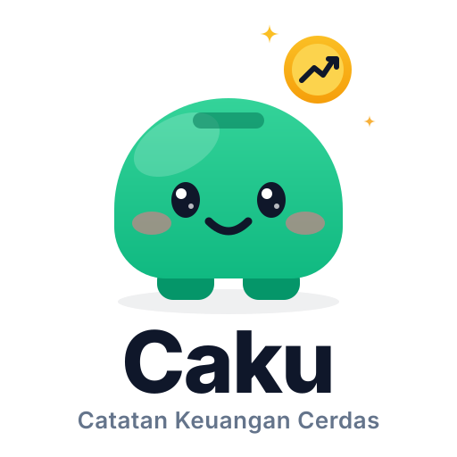

<p align="center">
  
</p>

<h1 align="center">Caku</h1>

<p align="center">
  <b>Catatan Keuangan Cerdas: Telegram Bot, Web Dashboard, dan Sinkronisasi Spreadsheet</b><br>
  Semua dalam satu binary Golang mandiri tanpa ketergantungan CGO.
</p>

<p align="center">
  
  
  
  
</p>

---

## Daftar Isi
- [Ikhtisar](#ikhtisar)
- [Fitur Utama](#fitur-utama)
- [Integrasi Google Sheets](#integrasi-google-sheets)
- [Panduan Instalasi & Menjalankan](#panduan-instalasi--menjalankan)
- [Format Input Telegram](#format-input-telegram)
- [Struktur Direktori](#struktur-direktori)
- [Keamanan & Produksi](#keamanan--produksi)

---

## Ikhtisar

**Caku** adalah aplikasi pembukuan dan catatan kas harian-bulanan yang dirancang cepat dan praktis. Pengguna dapat langsung mengetik pengeluaran atau pemasukan lewat bot Telegram, melihat grafik analitik serta tabel mutasi pada web dashboard, hingga mengekspor data ke Microsoft Excel dan Google Sheets.

Semua fitur dikompilasi ke dalam satu executable binary berkat implementasi pure Go SQLite (`modernc.org/sqlite`).

---

## Fitur Utama

### 1. Bot Telegram Interaktif
- **Parser Bahasa Alami**: Cukup ketik `-25000 Makan siang`, `+1.5jt Gaji`, atau `Beli bensin 25k`.
- **Auto-Kategorisasi Cerdas**: Mengenali kata kunci makanan, bensin, ojol, listrik, wifi, obat, hingga investasi.
- **Tabel Native Rich Message**: Menampilkan mutasi sebagai tabel Telegram asli (header, striping, border) dengan pagination in-place (`editMessageText`) tanpa spam chat.
- **Unduh CSV**: Mengirimkan file laporan kas bulanan langsung ke ruang obrolan Telegram.

### 2. Web Dashboard Editorial Light Mode
- Desain bersih bernuansa editorial koran keuangan klasik, bebas dari distraksi neon.
- Kartu KPI: Total Pemasukan, Pengeluaran, dan Saldo Kas Netto.
- Visualisasi Chart.js: Arus kas harian per tanggal dan komposisi beban per kategori.
- Saring transaksi ganda (real-time live search teks + segmented pill button: Semua, Pengeluaran, Pemasukan).
- Input cepat natural language dan modal form lengkap.
- Kelola penuh dari tabel: tambah, baca, **edit**, dan hapus transaksi (CRUD).
- Diproteksi login session token acak 192-bit anti timing-attack (`crypto/subtle`).

### 3. Ekspor & Sinkronisasi Spreadsheet
- Format CSV berstandar **UTF-8 BOM** sehingga karakter dan angka langsung terbaca tepat oleh Microsoft Excel dan LibreOffice Calc tanpa error encoding.
- **Google Sheets sebagai database**: setiap transaksi baru, edit, dan hapus langsung ditulis ke spreadsheet melalui Apps Script Web App. Tombol **Sync Semua** menulis ulang seluruh data lokal saat rekonsiliasi.

---

## Integrasi Google Sheets

Terdapat tiga cara praktis menghubungkan data Caku dengan Google Sheets:

### Opsi A: Live Sync Dua Arah via Apps Script (Direkomendasikan)
Jadikan Google Sheet sebagai database: setiap catat, edit, dan hapus dari Telegram maupun web langsung menulis baris di spreadsheet.
1. Buka dashboard Caku, klik **Hubungkan Google Sheets** di header.
2. Salin template Apps Script yang muncul.
3. Di spreadsheet: **Extensions** -> **Apps Script** -> tempel kode -> **Deploy** -> **New deployment** -> **Web app** (Execute as: Me, Who has access: Anyone).
4. Simpan URL deployment ke `.env`:
   ```env
   GOOGLE_SHEET_WEBAPP_URL=https://script.google.com/macros/s/.../exec
   ```
5. Restart Caku. Badge **Google Sheets Aktif** muncul, dan tombol **Sync Semua** siap merekonsiliasi data lokal.

### Opsi B: Live Sync Baca via IMPORTDATA
Google Sheets dapat membaca langsung data mutasi Caku melalui URL ekspor:
1. Buka spreadsheet Google Sheets Anda.
2. Di sel `A1`, masukkan formula:
   ```excel
   =IMPORTDATA("http://ip-server-anda:8080/export/csv?month=2026-11")
   ```
3. Google Sheets akan menarik seluruh kolom mutasi transaksi secara real-time berkala.

### Opsi C: Unduh & Buka (Manual)
1. Klik tombol **Unduh CSV** di Web Dashboard atau ketik `/export` di Telegram.
2. Buka Google Sheets -> **File** -> **Import** -> **Upload** file `.csv`.

---

## Panduan Instalasi & Menjalankan

### 1. Prasyarat
- Go versi 1.25 atau lebih baru
- Token Bot Telegram dari [@BotFather](https://t.me/BotFather) (opsional jika hanya memakai web)

### 2. Clone Repositori
```bash
git clone https://github.com/username/caku.git
cd caku
```

### 3. Konfigurasi Environment
Salin template konfigurasi:
```bash
cp .env.example .env
```

Sesuaikan isi `.env`:
```env
CAKU_DB_PATH=data/caku.db
CAKU_PORT=8080

# Kredensial login Web Dashboard (Wajib diganti!)
CAKU_WEB_USER=admin
CAKU_WEB_PASS=ganti_dengan_password_anda

# Token dari @BotFather (opsional)
TELEGRAM_BOT_TOKEN=123456789:ABCDefghIJKLmnOPQRstuvWXYZ

# Google Sheets sebagai database (opsional, lihat Opsi A)
GOOGLE_SHEET_WEBAPP_URL=
```

### 4. Build dan Eksekusi
```bash
# Unduh dependency
go mod download

# Build binary
go build -o caku .

# Jalankan
./caku
```
Buka browser di `http://localhost:8080`.

---

## Format Input Telegram

Bot mengenali ragam sintaks penulisan kas tanpa perlu mengisi formulir panjang:

| Format Input | Tipe | Terdeteksi Sebagai |
|---|---|---|
| `-25000 Makan siang warteg` | Pengeluaran | Rp 25.000 (Makanan & Minuman) |
| `+1500000 Gaji bulanan` | Pemasukan | Rp 1.500.000 (Gaji & Upah) |
| `Beli bensin 25k` | Pengeluaran | Rp 25.000 (Transportasi) |
| `Bonus project 2.5jt` | Pemasukan | Rp 2.500.000 (Bonus & THR) |
| `Bayar wifi indihome 350rb` | Pengeluaran | Rp 350.000 (Tagihan & Utilitas) |

Perintah navigasi bot:
- `/hari` : Rekapitulasi transaksi hari ini
- `/laporan` : Ringkasan kas bulan berjalan beserta persentase kategori
- `/tabel` : Riwayat mutasi dengan tombol pagination interaktif
- `/kategori` : Visualisasi progress bar pengeluaran per sektor
- `/export` : Kirim dokumen CSV ke obrolan
- `/help` : Panduan bantuan

---

## Struktur Direktori

```text
caku/
├── .env.example            # Template variabel environment
├── go.mod                  # Manifes modul Go
├── main.go                 # Entrypoint server & graceful shutdown
├── internal/
│   ├── exporter/           # Generator CSV kompatibel Excel & Sheets
│   ├── format/             # Formatter nominal, rich table, progress bar
│   ├── gsheet/             # Sinkronisasi database Google Sheets via Apps Script
│   ├── models/             # Schema SQLite, query, dan unit test
│   ├── parser/             # NLP parser input transaksi & auto-kategori
│   ├── telebot/            # Long polling client Telegram & in-place update
│   └── web/                # HTTP handler, session auth, dan REST API
└── web/
    ├── static/             # Asset logo.svg & icon.svg
    └── templates/          # Template dashboard.html & login.html
```

---

## Keamanan & Produksi

1. **Perbandingan Waktu Konstan**: Validasi kredensial login menggunakan `crypto/subtle.ConstantTimeCompare` guna mencegah serangan side-channel timing.
2. **Session Acak**: Token session dibuat via `crypto/rand` berkekuatan 192-bit disimpan dalam cookie `HttpOnly` dan `SameSite=Lax`.
3. **Database Parameterized**: Semua operasi SQLite menggunakan prepared statement untuk mencegah injeksi SQL.
4. **Rekomendasi Reverse Proxy**: Untuk penggunaan publik, jalankan di belakang reverse proxy seperti Nginx atau Caddy untuk terminasi HTTPS.

---

## Lisensi

Proyek ini dirilis di bawah lisensi MIT.
